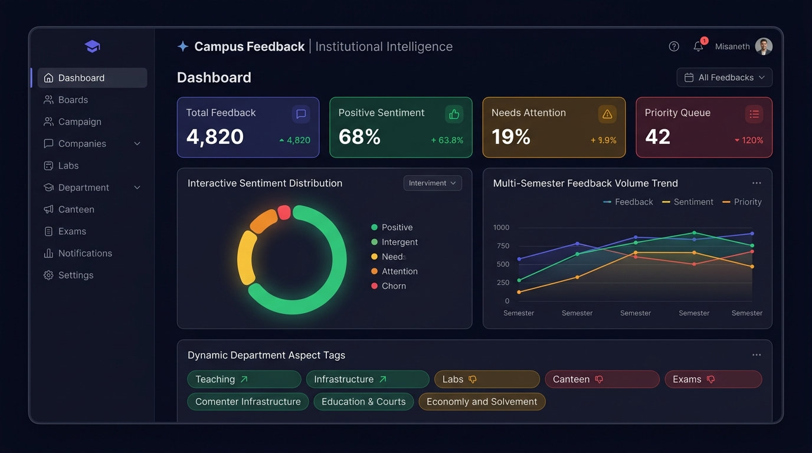
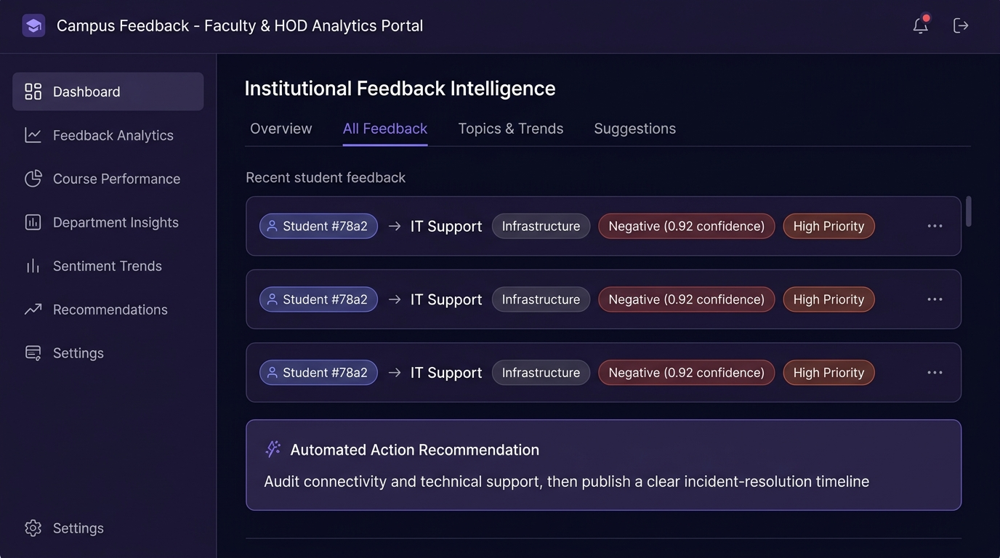
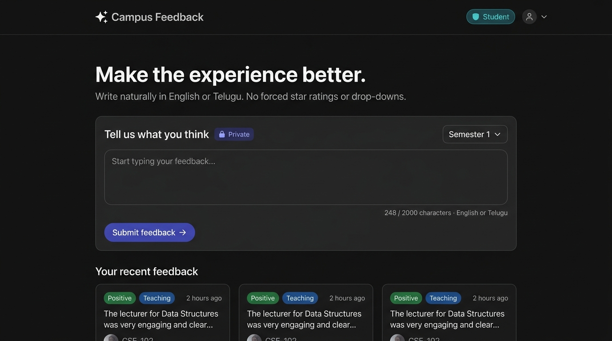
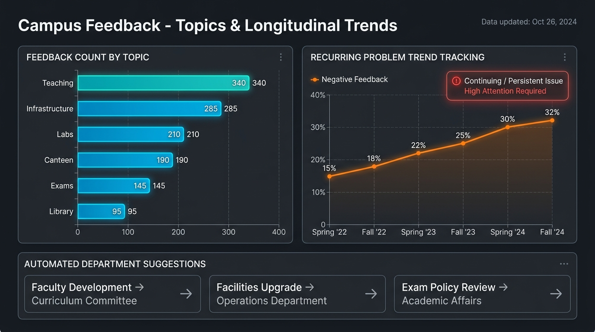
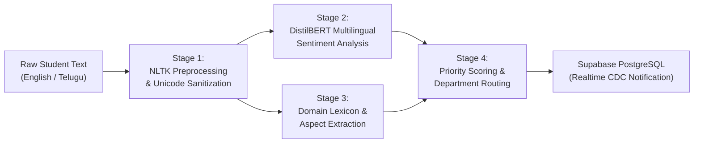
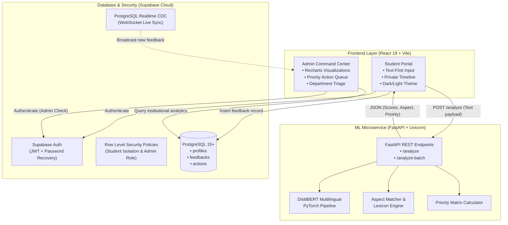
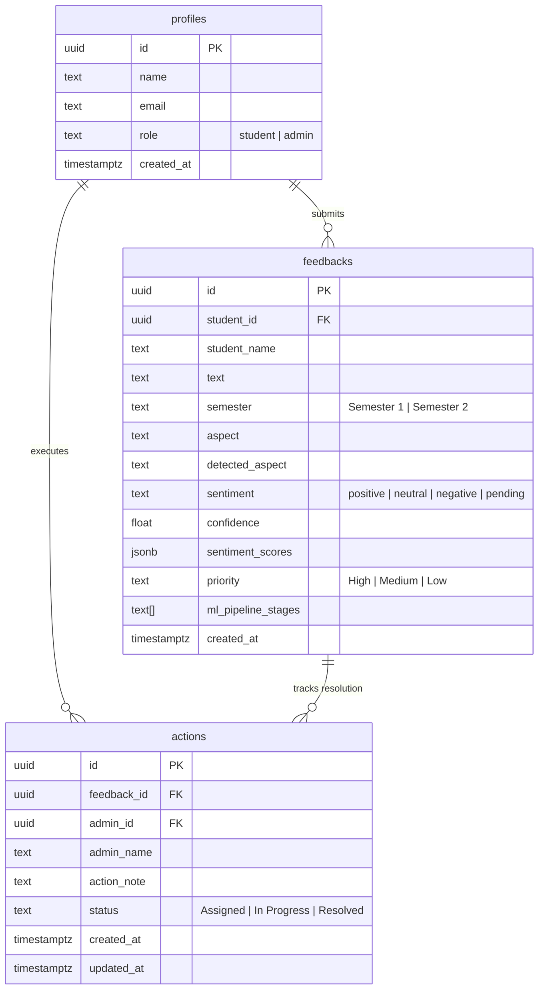

<div align="center">

# ✦ Campus Feedback Analyzer
### Enterprise AI-Powered Student Feedback Intelligence & Institutional Analytics Platform

[](https://student-feedback-app-sable-two.vercel.app/)
[](https://fastapi.tiangolo.com/)
[](https://react.dev/)
[](https://huggingface.co/lxyuan/distilbert-base-multilingual-cased-sentiments-student)
[](https://supabase.com/)
[](LICENSE)

<br/>



<br/>

**A zero-friction, text-first academic intelligence system that bridges the gap between student experiences and institutional action.** Powered by transformer-based Natural Language Processing, bilingual understanding (English & Telugu), real-time PostgreSQL CDC telemetry, and longitudinal problem trend tracking.

[🚀 Explore Live Application](https://student-feedback-app-sable-two.vercel.app/) • [📊 View Architecture](#-system-architecture) • [🧠 ML Pipeline](#-4-stage-asynchronous-ml-pipeline) • [🛡️ Security & RLS](#%EF%B8%8F-enterprise-database-schema--row-level-security) • [⚡ Quickstart](#-getting-started--local-development)

</div>

---

## 🌟 Executive Overview & The Problem

Traditional institutional feedback loops are broken:
- **Survey Fatigue & Low Signal**: Long Likert-scale questionnaires (1–5 stars) result in rushed, unrepresentative click-through submissions.
- **Lost Context**: Number ratings fail to capture the nuance of *why* a student was frustrated or *which* specific campus element was defective.
- **Latency in Intervention**: Feedback collected once at the end of a semester arrives months after issues have escalated.
- **Linguistic Barriers**: Multilingual student populations often express genuine frustration in native or transliterated languages that standard sentiment models misinterpret.

**Campus Feedback** re-engineers institutional listening from the ground up:
1. **Frictionless, Text-First Input**: Students express themselves naturally in English or Telugu without tedious forced dropdowns or arbitrary star ratings.
2. **Deep Semantic Understanding**: A fine-tuned multilingual **DistilBERT** transformer categorizes raw narrative feedback into sentiment distributions, detects targeted campus aspects, and scores urgency in under 120ms.
3. **Automated Escalation & Department Routing**: Critical issues (harassment, broken lab hardware, power outages, food hygiene) are routed instantaneously to responsible administrative divisions (IT Support, Academic, Operations, Finance, Library).
4. **Longitudinal Problem Tracking**: Heads of Department (HODs) track whether student pain points are **Newly Emerging**, **Improving**, **Worsening**, or **Continuing / Persistent** across academic semesters.

---

## 🚀 Live Demo & Interactive Credentials

| Environment | Endpoint / URL | Access Details |
| :--- | :--- | :--- |
| **Production Frontend** | [student-feedback-app-sable-two.vercel.app](https://student-feedback-app-sable-two.vercel.app/) | Deployed globally on Vercel Edge |
| **Student Portal** | [Access Application](https://student-feedback-app-sable-two.vercel.app/) | Self-service sign-up or sign-in with your personal email |
| **HOD / Administrator Portal** | [Access Application](https://student-feedback-app-sable-two.vercel.app/) | **Email**: `admin@studentfeedback.in`<br/>**Password**: `Admin123` |
| **ML Inference Engine** | `FastAPI / Uvicorn` (port 8000) | `POST /analyze` & `POST /analyze-batch` |

> [!IMPORTANT]
> **Strict Role Separation**: The administrator portal is protected by database-level Row Level Security (RLS). Students cannot self-elevate to administrative privileges through the user interface; administrative access requires the reserved cryptographic identity.

---

## 📸 Platform Interface Gallery

### 1. HOD & Administrator Institutional Command Center
The administrative dashboard aggregates real-time institutional KPIs, sentiment ratios, longitudinal feedback volume curves, and automated cross-departmental action recommendations.

<div align="center">
  
  <p><em>Figure 1: Real-time feedback triage, aspect tagging, sentiment confidence scoring, and automated action proposals.</em></p>
</div>

---

### 2. Zero-Friction Student Experience & Natural Language Composer
Designed with dark/light theme persistence, end-to-end anonymity assurance, and single-input clarity. Students submit narrative feedback and track their historical submission statuses.

<div align="center">
  
  <p><em>Figure 2: Text-first composer supporting English & Telugu with instant client validation and private feedback history.</em></p>
</div>

---

### 3. Topics, Sentiment Distribution & Longitudinal Trend Intelligence
HODs can monitor aspect breakdowns (Teaching, Infrastructure, Labs, Canteen, Exams, Library) and track whether recurring negative feedback is resolving or escalating over time.

<div align="center">
  
  <p><em>Figure 3: Semantic topic distribution alongside semester-over-semester problem trajectory classification.</em></p>
</div>

---

## 🧠 4-Stage Asynchronous ML Pipeline

When a student submits feedback, it traverses an optimized 4-stage natural language processing pipeline:



### Stage 1: Multilingual Preprocessing & Unicode Normalization
- Converts strings to normalized lowercase representation.
- Cleans punctuation and non-alphanumeric noise while explicitly preserving **Telugu Unicode script (`\u0C00–\u0C7F`)** and transliterated romanized Telugu keywords.
- Tokenizes words with NLTK Punkt to eliminate duplicate spacing and malformed whitespace.

### Stage 2: Transformer-Based Multilingual Sentiment Classification
- **Model**: `lxyuan/distilbert-base-multilingual-cased-sentiments-student`
- Fine-tuned specifically on academic and educational domain sentiment.
- Generates continuous probability distributions over 3 distinct classes:
  $$\sum (P_{\text{positive}} + P_{\text{neutral}} + P_{\text{negative}}) = 1.0$$
- Dominant class extracted with exact confidence scoring:
  $$\text{Confidence} = \max\left(P_{\text{positive}}, P_{\text{neutral}}, P_{\text{negative}}\right)$$

### Stage 3: Aspect & Topic Extraction Engine
Categorizes feedback into six operational campus dimensions using an expanded domain lexicon that accommodates both standard English terminology and romanized Telugu transliterations:

| Campus Aspect | English Lexical Anchors | Telugu Transliteration Anchors |
| :--- | :--- | :--- |
| **Teaching** | `teacher`, `faculty`, `professor`, `lecture`, `syllabus`, `curriculum`, `notes`, `doubt` | `adhyapakudu`, `paatha`, `vidya`, `upanyasam` |
| **Labs** | `lab`, `equipment`, `experiment`, `practical`, `machine`, `software`, `hardware`, `pc` | `prayogasala`, `yantralu` |
| **Infrastructure** | `wifi`, `internet`, `network`, `bench`, `fan`, `ac`, `washroom`, `toilet`, `projector` | `mandiram`, `vidyut` |
| **Canteen** | `canteen`, `food`, `mess`, `meal`, `lunch`, `taste`, `hygiene`, `clean`, `price`, `cost` | `aaharam`, `bhojanam` |
| **Exams** | `exam`, `test`, `grade`, `marks`, `result`, `timetable`, `hall ticket`, `assessment` | `pariksha`, `markulu` |
| **Library** | `library`, `book`, `journal`, `reading room`, `digital access`, `study material` | `granthalayam`, `pustakam` |

### Stage 4: Priority & Risk Escalation Engine
Evaluates feedback urgency to ensure safety hazards, laboratory breakdowns, and critical administrative blockers are addressed immediately:

$$\text{Urgency Terms} = \{\text{'urgent'}, \text{'immediately'}, \text{'unsafe'}, \text{'danger'}, \text{'broken'}, \text{'emergency'}, \text{'harassment'}, \text{'threat'}, \dots\}$$

$$\text{Priority} = \begin{cases} 
\text{High} & \text{if } \text{Sentiment} = \text{Negative} \text{ and } (\text{Confidence} \ge 0.80 \text{ or } \text{Urgency Count} \ge 2) \\ 
\text{Medium} & \text{if } \text{Sentiment} = \text{Negative} \text{ or } (\text{Sentiment} = \text{Neutral} \text{ and } \text{Urgency Count} \ge 1) \\ 
\text{Low} & \text{otherwise} 
\end{cases}$$

---

## 📈 Longitudinal Trend Tracking Algorithm

To prevent recurrent issues from being forgotten across semesters, the analytics engine groups negative feedback by academic semester and applies a dynamic slope evaluation algorithm:

$$\text{Tolerance} = \max\left(1, \, \text{Count}_{\text{first}} \times 0.20\right)$$

$$\text{Trajectory} = \begin{cases}
\text{Newly Emerging} & \text{if } \text{Active Semesters} < 2 \\
\text{Improving} & \text{if } \text{Count}_{\text{last}} < \text{Count}_{\text{first}} - \text{Tolerance} \\
\text{Worsening} & \text{if } \text{Count}_{\text{last}} > \text{Count}_{\text{first}} + \text{Tolerance} \\
\text{Continuing / Persistent} & \text{otherwise}
\end{cases}$$

This mathematical qualification provides leadership with immediate insight into whether capital expenditures or operational interventions are actually resolving student distress.

---

## 🏛️ System Architecture



---

## 🛡️ Enterprise Database Schema & Row Level Security

The persistent layer is backed by **Supabase PostgreSQL** with strict cryptographic isolation ensuring student anonymity and preventing horizontal privilege escalation.

### Database Tables & Relationships



### Row Level Security (RLS) Policy Highlights

```sql
-- Security Definer to verify admin authorization securely
CREATE OR REPLACE FUNCTION public.is_admin() RETURNS BOOLEAN
LANGUAGE sql SECURITY DEFINER SET search_path = public STABLE AS $$
  SELECT EXISTS (
    SELECT 1 FROM public.profiles WHERE id = auth.uid() AND role = 'admin'
  );
$$;

-- Students may ONLY view their own submitted feedbacks
CREATE POLICY "Students can view own feedback" ON feedbacks FOR SELECT
USING (auth.uid() = student_id);

-- Administrators have global visibility across all submissions
CREATE POLICY "Admins can view all feedback" ON feedbacks FOR SELECT
USING (public.is_admin());

-- Feedbacks can only be permanently purged if an authorized resolution action exists
CREATE POLICY "Admins can delete resolved feedback" ON feedbacks FOR DELETE
USING (
  public.is_admin()
  AND EXISTS (
    SELECT 1 FROM public.actions
    WHERE actions.feedback_id = feedbacks.id
      AND actions.status = 'Resolved'
  )
);
```

---

## ⚡ Getting Started & Local Development

### Prerequisites
- **Python 3.10+**
- **Node.js 18+** & `npm`
- Free **Supabase** account or self-hosted PostgreSQL instance

### Quick Start (One Command)
If running in a Unix-like environment (macOS, Linux, WSL, Git Bash):

```bash
chmod +x start.sh
./start.sh
```

---

### Step-by-Step Manual Setup

#### 1. Clone Repository
```bash
git clone https://github.com/Sashank096/student-feedback.git
cd student-feedback
```

#### 2. Backend Setup (FastAPI + Hugging Face)
```bash
cd backend

# Create and activate virtual environment
python -m venv .venv

# Windows:
.venv\Scripts\activate
# macOS / Linux:
source .venv/bin/activate

# Install dependencies
pip install -r requirements.txt

# Start ML API server
python main.py
```
*API will be operational at `http://localhost:8000` with interactive Swagger docs at `http://localhost:8000/docs`.*

#### 3. Database Migration (Supabase)
1. Navigate to the **SQL Editor** in your Supabase dashboard.
2. Open [`supabase_schema.sql`](supabase_schema.sql) and execute the script.
3. In Supabase Auth, invite or create the authorized administrator user:
   - **Email**: `admin@studentfeedback.in`
   - **Password**: `Admin123` *(or your custom secure credential)*

#### 4. Frontend Setup (React 18 + Vite)
```bash
cd ../frontend

# Configure environment variables
cp .env.example .env
```

Populate `frontend/.env`:
```ini
VITE_SUPABASE_URL=https://your-project-id.supabase.co
VITE_SUPABASE_PUBLISHABLE_KEY=your-anon-key
VITE_ML_API_URL=http://localhost:8000
```

```bash
# Install packages and start development server
npm install
npm run dev
```
*Open `http://localhost:5173` to access the application.*

---

## 📡 API Specification

### `POST /analyze`
Synchronous inference for single student feedback submission.

**Request Payload:**
```json
{
  "text": "The computer systems in the advanced lab keep turning off during practicals. Very urgent!",
  "subject": ""
}
```

**Response Payload (`200 OK`):**
```json
{
  "original_text": "The computer systems in the advanced lab keep turning off during practicals. Very urgent!",
  "cleaned_text": "the computer systems in the advanced lab keep turning off during practicals very urgent",
  "sentiment": "negative",
  "confidence": 0.9421,
  "scores": {
    "positive": 0.0142,
    "neutral": 0.0437,
    "negative": 0.9421
  },
  "aspect": "Labs",
  "priority": "High",
  "pipeline_stages": [
    "text_preprocessing",
    "distilbert_sentiment",
    "keyword_aspect_detection",
    "rule_based_priority"
  ]
}
```

---

## 🗂️ Project Structure

```
student-feedback/
├── backend/
│   ├── main.py                  # FastAPI REST endpoints & CORS configuration
│   ├── ml_pipeline.py           # 4-stage NLP pipeline (DistilBERT + NLTK + Aspect matcher)
│   └── requirements.txt         # Pinned backend dependencies
├── frontend/
│   ├── src/
│   │   ├── lib/
│   │   │   └── supabase.js      # Supabase client instantiation & API endpoints
│   │   ├── pages/
│   │   │   ├── FacultyPage.jsx  # HOD / Admin intelligence command center & Recharts
│   │   │   ├── LoginPage.jsx    # Dual-persona authentication & password recovery
│   │   │   ├── ResetPasswordPage.jsx # Reset password handler
│   │   │   └── StudentPage.jsx  # Text-first student feedback submission portal
│   │   ├── App.css              # Glassmorphic, light/dark adaptive design system
│   │   ├── App.jsx              # Session routing & role-based gatekeeper
│   │   └── main.jsx             # React DOM entry point
│   ├── package.json             # Frontend dependencies (React, Vite, Recharts)
│   └── vite.config.js           # Vite build & proxy settings
├── docs/
│   └── images/                  # High-resolution UI screenshots & architectural banners
├── start.sh                     # Unified startup script for backend & frontend
├── supabase_schema.sql          # Production database schema, triggers & RLS policies
└── README.md                    # Master documentation
```

---

## 👨‍💻 Engineering & Author Showcase

<div align="center">

Developed with passion by **Sashank Reddy**  
*Full-Stack Engineer & Machine Learning Specialist*

[](https://github.com/Sashank096)
[](https://www.linkedin.com/in/sashank-reddy/)

*Interested in enterprise institutional intelligence or conversational AI solutions? Feel free to connect or open an issue!*

</div>
